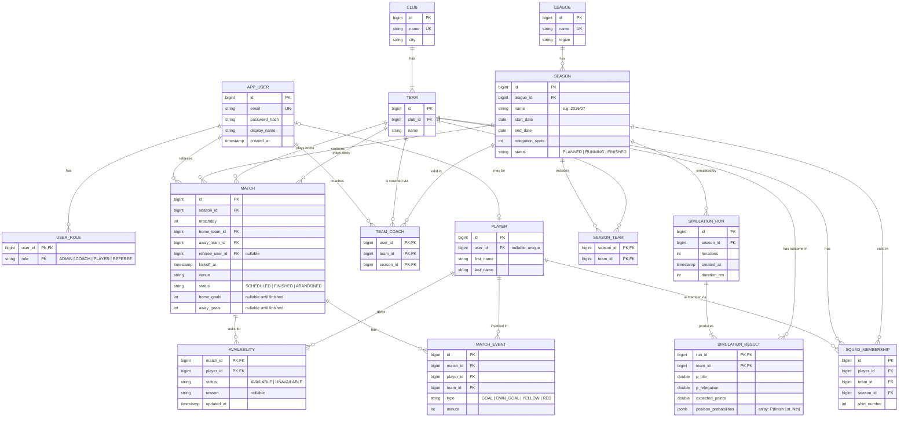

# Matchday – Domain Model

Version: 0.1
Date: 2026-11-27

## 1. Entities

| Entity | Description |
|---|---|
| **AppUser** | A person with a login account. Holds credentials and roles. |
| **UserRole** | A role assigned to a user (ADMIN, COACH, PLAYER, REFEREE). One user can have several. |
| **Club** | A football club, e.g. "Weimarer SV". |
| **Team** | A team belonging to a club, e.g. "Weimarer SV II". |
| **League** | A competition, e.g. "Kreisliga Weimar". |
| **Season** | One edition of a league, e.g. "2026/27". |
| **SeasonTeam** | Which teams take part in which season. |
| **Player** | A football player profile. May or may not be linked to a user account. |
| **SquadMembership** | A player's membership in a team for one season. |
| **TeamCoach** | A user who coaches a team in a season. |
| **Match** | A scheduled or played game between two teams in a season. |
| **MatchEvent** | Something that happened in a match: goal, own goal, yellow or red card. |
| **Availability** | A player's response (available / unavailable) for a match. |
| **SimulationRun** | One execution of the Monte Carlo season simulator. |
| **SimulationResult** | Per-team outcome probabilities from one simulation run. |

**Computed (not stored):** league table, player statistics, top scorers.

## 2. ER diagram

## 3. Constraints (business rules)

| # | Rule | Source |
|---|---|---|
| K1 | `home_team_id <> away_team_id` | common sense |
| K2 | Home and away team must both be in `SEASON_TEAM` for the match's season | A1 |
| K3 | A team plays at most one match per matchday in a season | A1 |
| K4 | Unique `(season_id, home_team_id, away_team_id)`: each pairing once at home, once away | A1 |
| K5 | Unique `(player_id, season_id)` in `SQUAD_MEMBERSHIP`: one team per player per season | C2 |
| K6 | A referee cannot have two matches with the same `kickoff_at` | A2 |
| K7 | Only the assigned referee may submit a match report; afterwards status = FINISHED and the report is locked | R1 |
| K8 | A match event's player must be in the squad of the event's team, and that team must be home or away in the match | R1 |
| K9 | Availability can only be changed while `now() < kickoff_at` | P1 |
| K10 | `home_goals` and `away_goals` are set if and only if status = FINISHED | R1 |
| K11 | Unique shirt number per team per season | common sense |

Some rules are enforced **in the database** (K1, K4, K5, K10, K11 via CHECK or UNIQUE constraints), others **in the application** (K2, K3, K6–K9), because they need queries across tables or depend on the current user or time.

## 4. Design decisions

**D1 – One `AppUser` with roles instead of separate User/Coach/Referee tables.**
One person can be a player *and* a referee (common in amateur football). Roles are
stored in `USER_ROLE` (many roles per user). Named `app_user` because `user` is a
reserved word in PostgreSQL.

**D2 – `Player` is separate from `AppUser`.**
A coach must be able to add players to the squad who don't (yet) have an account.
If a player signs up, their account is linked via `player.user_id`.

**D3 – Squad membership is a join entity per season.**
Putting `team_id` directly on `Player` would lose history when a player changes
teams: last season's goals would suddenly count for the new team.
`SQUAD_MEMBERSHIP (player, team, season)` keeps history correct.

**D4 – Match has two foreign keys to Team (home and away).**
Not a many-to-many table, because a match always has exactly two teams with
different roles (home/away).

**D5 – Fixture, Match and Matchday are one entity.**
A fixture is a match with status SCHEDULED; a result is the same match with
status FINISHED. Matchday is just an integer attribute.

**D6 – Goals and cards are one `MATCH_EVENT` entity with a `type`.**
They share the same structure (match, player, team, minute). Adding a new event
type later (e.g. substitution) needs no schema change.

**D7 – Score is stored on `MATCH`, not only derived from events.**
In amateur football the referee always reports the final score, but goal scorers
are sometimes missing. The score on `MATCH` is the source of truth for the
league table; `MATCH_EVENT` is the source for player statistics.

**D8 – League table and statistics are computed, not stored.**
They are derived from finished matches. This avoids inconsistencies when an admin
corrects a result (A3). With few teams and matches the calculation is cheap;
caching can be added later if needed.

**D9 – Club and Team are separate.**
A club can have several teams (first team, second team, youth). Teams, not
clubs, play in leagues.

**D10 – Simulation results are stored per run.**
Unlike the table, a simulation is expensive (100,000 iterations) and random, so
results are saved and shown with their timestamp (G4). Position probabilities
are stored as JSONB because their length depends on the number of teams.

## 5. Not in MVP (later additions)
- `RESULT_CORRECTION` (audit log for A3)
- External league data (E1), probably in a separate schema
- Notifications